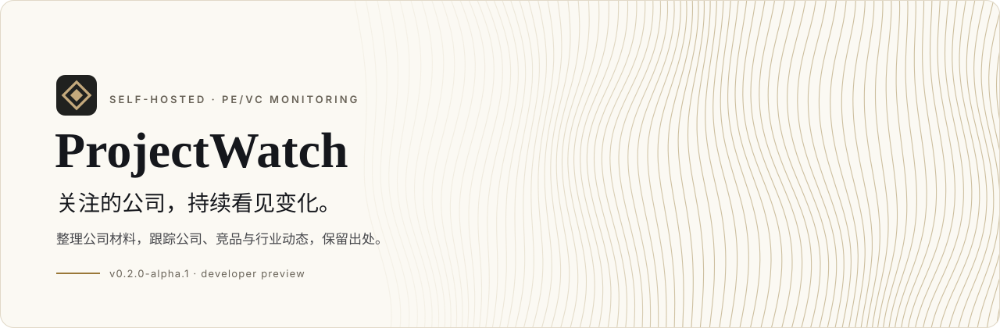
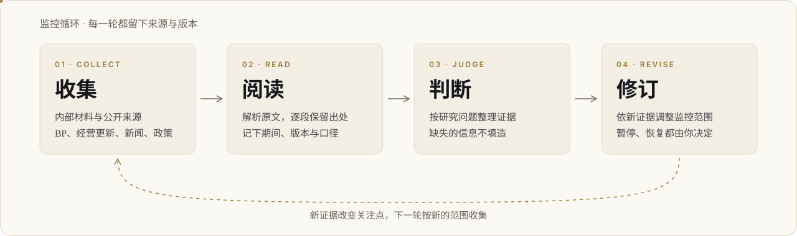
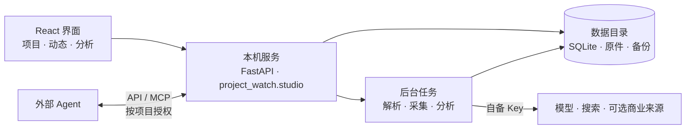

<a id="top"></a>

<picture>
  <source media="(prefers-color-scheme: dark)" srcset="docs/assets/readme/hero-dark.svg">
  
</picture>

<p align="center">
  <a href="https://github.com/lensnowovo/ProjectWatch-Community/releases/tag/v0.2.0-alpha.1"></a>
  
  
  <a href="LICENSE"></a>
</p>

<p align="center">
  <a href="https://github.com/lensnowovo/ProjectWatch-Community/releases/tag/v0.2.0-alpha.1"><b>下载预览版</b></a> ·
  <a href="#快速开始">快速开始</a> ·
  <a href="docs/developer-architecture.md">架构</a> ·
  <a href="docs/developer-known-limitations.md">已知边界</a> ·
  <a href="docs/release-notes-v0.2.0-alpha.1.md">版本说明</a>
</p>

<br>

**ProjectWatch** 是个人可自部署的 PE/VC 项目监控平台：上传内部材料，跟踪公开动态，整理公司、竞品、技术路线和行业环境，以来源和证据支持后续判断。

它跑在你自己的电脑上，用你自己的模型与搜索配置。每一条结论都能追到原文出处；资料里没有的，它不替你补。

> [!NOTE]
> 当前版本为 **v0.2.0-alpha.1 开发者预览版**，维护者 **qzqzqz**。已有分析实现、提示词、规则与页面全部保留，不依赖另一个私有分析包。
> 完整功能不代表所有场景都已生产验收；没有 Key 时可看界面，不能进行真实模型分析。

<br>

## 它怎么工作

<picture>
  <source media="(prefers-color-scheme: dark)" srcset="docs/assets/readme/loop-dark.svg">
  
</picture>

配置自己的模型与搜索服务 → 输入公司名或 BP → 确认公司 → 查看内部资料、公开动态和分析 → 调整监控或通过 Agent 追问 → 持续更新与备份。

<br>

## 能做什么

| 能力 | 说明 |
|---|---|
| **内部资料** | 解析 BP、经营更新和财务材料，保留原件、来源、期间和版本。 |
| **外部动态** | 公司动态、竞品、行业、政策，以及可用的论文、专利和注册线索。 |
| **分析** | 竞争位置、技术路线、行业环境、问题证据和内外对照；缺失信息不填造。 |
| **接入** | 自备模型/搜索配置、可选商业来源、API/MCP 与外部 Agent 授权写回。 |
| **运行** | 任务与用量回执、暂停/恢复、未知付费结果保护、备份与恢复。 |

<br>

## 设计上的取舍

- **证据先于结论。** 判断挂在原文摘录上，点开就能看到出处、期间和版本；AI 的提议和公开信号不会被当成已确认的投资事实。
- **不填空。** 材料没写营业成本，就不算毛利率；没检索到的事，界面会写明"未收录不代表没有发生"。
- **本机优先。** 数据目录、数据库和原件都在你的机器上，服务只监听本机，不直接暴露公网。
- **花钱的请求有回执。** 每次模型和搜索调用都记账；结果不明的付费请求不会被自动重发。
- **你的 Key，你的数据。** 软件不附送 Key，不远程停用，不读取你的业务数据。

<br>

## 快速开始

推荐 Windows x64、Python 3.12、Node.js 22+。先克隆仓库，再在源码根目录运行：

```powershell
git clone https://github.com/lensnowovo/ProjectWatch-Community.git
cd ProjectWatch-Community
py -3.12 -m venv .venv-developer
.\.venv-developer\Scripts\python.exe -m pip install --upgrade "pip>=26.2"
.\.venv-developer\Scripts\python.exe -m pip install -e ".[dev,team,mcp,postgres]" build ruff
npm --prefix frontend ci
npm --prefix frontend run build
$env:PROJECT_WATCH_HOME = Join-Path $env:LOCALAPPDATA 'ProjectWatch-developer-sandbox'
.\.venv-developer\Scripts\python.exe -m project_watch.studio --port 8901 --strict-port --no-browser
```

打开 `http://127.0.0.1:8901/`。

> [!IMPORTANT]
> 使用独立数据目录，不与已有实例共用；端口占用请换端口，不要停止不相关的服务。本机服务不能直接暴露公网。

- 双击 `Start-ProjectWatch.cmd` 可使用本机启动器；首次需安装依赖，默认包含可选 OCR。
- 前端热更新使用 Vite，生产页面由 `npm --prefix frontend run build` 写入 Python 包。
- 完整步骤及前端热更新见 [开发指南](docs/developer-quickstart.md)。

<details>
<summary><b>验证与构建</b></summary>

<br>

```powershell
.\.venv-developer\Scripts\python.exe -X utf8 -m pytest tests -q
node --test tests/*.test.mjs
npm --prefix frontend test
npm --prefix frontend run typecheck
npm --prefix frontend run build
.\.venv-developer\Scripts\python.exe -m build --wheel
```

新技术包名 `projectwatch-local`，导入名 `project_watch`。
这不代表同名公共包索引登记；使用本次源码或已核验哈希的 wheel。
与旧 `greenpine-project-watch` 不能混装，升级另建环境并验证备份，原数据不随 Git 分发。
可选 OCR/MCP 和独立安装验证见开发指南；PostgreSQL 测试须专用空 `_test` 数据库。

</details>

<br>

## 架构一览



目录结构与模块分层见 [架构与目录](docs/developer-architecture.md)。

<br>

## 文档

| 文档 | 内容 |
|---|---|
| [开发指南](docs/developer-quickstart.md) | 安装、启动、前端热更新、可选 OCR/MCP |
| [架构与目录](docs/developer-architecture.md) | 模块分层与数据流 |
| [已知边界](docs/developer-known-limitations.md) | 哪些能力尚未生产验收 |
| [参与开发](docs/contributing.md) | 提交、测试与贡献授权 |
| [安全问题反馈](docs/security-reporting.md) | 漏洞报告渠道 |

<br>

## 许可与隐私

目标为完整源码可用（source-available）：机构内部自用免费，仅对外商业服务需取得维护者授权，不宣传为 OSI 开源。
本版本的自有代码采用 [ProjectWatch 社区使用许可 1.0](LICENSE)，商业授权联系：**lensnowovo@gmail.com**。
自身基金的投委会/LP 报告，以及客户控制实例下的纯安装、培训、修复和定制劳务，不因收费而自动要求软件商业授权；
对外经营托管、API、白标或监控/分析订阅服务须事先书面授权。免费 fork 和修改版分发须保留许可与通知，
分发修改二进制时提供对应源码；仅内部使用的修改无需公开。具体范围以 LICENSE 为准。

第三方组件、字体及依赖继续适用各自许可，详见 [NOTICE](NOTICE)。[历史 Apache 文本](LICENSES/Apache-2.0.txt)
保留既有授权，不把本版本新增或改许可的部分重新授权为 Apache。已有授权不会因新仓库而追溯撤回。
本次为开发者预览，不是稳定生产版本。使用和再分发时须同时遵守第三方原有许可。

Key、真实 BP、商业返回、数据库、日志和备份必须保存在源码外。配置外部模型前确认材料披露范围，
第三方服务的使用与转售权利需自行取得，软件许可不替代数据服务合同。

<br>

<p align="center">
  <sub>ProjectWatch · © 2026 qzqzqz · <a href="#top">回到顶部 ↑</a></sub>
</p>
