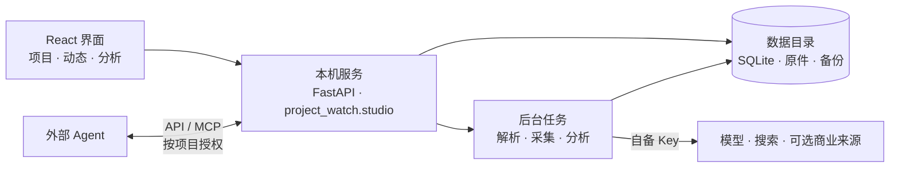

<a id="top"></a>

<picture>
  <source media="(prefers-color-scheme: dark)" srcset="docs/assets/readme/hero-dark.svg">
  
</picture>

<p align="center">
  <a href="https://github.com/lensnowovo/ProjectWatch-Community/releases/tag/v0.2.0rc3-preview.1"></a>
  
  
  <a href="LICENSE"></a>
</p>

<p align="center">
  <a href="https://github.com/lensnowovo/ProjectWatch-Community/releases/tag/v0.2.0rc3-preview.1"><b>Windows 预览版与下载清单</b></a> ·
  <a href="#快速开始">快速开始</a> ·
  <a href="docs/developer-architecture.md">架构</a> ·
  <a href="docs/developer-known-limitations.md">已知边界</a> ·
  <a href="docs/releases/0.2.0rc3-preview.1.md">版本说明</a>
</p>

<br>

**ProjectWatch** 是个人可自部署的 PE/VC 项目监控平台：上传内部材料，跟踪公开动态，整理公司、竞品、技术路线和行业环境，以来源和证据支持后续判断。

它跑在你自己的电脑上，用你自己的模型与搜索配置。分析尽量附带来源，缺失信息保留为空；模型输出仍可能出错，重要结论请查看原始材料。

> [!NOTE]
> 本次版本为 **0.2.0rc3 Windows x64 公开预览版**，维护者 **qzqzqz** 已授权发布；以[指定版本页](https://github.com/lensnowovo/ProjectWatch-Community/releases/tag/v0.2.0rc3-preview.1)实际列出的资产为准。已有分析实现保留，不依赖另一个私有分析包。
> 安装器未签名，Mac 新版本暂缓。真实分析质量、新闻发现时效、独立用户首次使用和连续 48 小时观察尚未验证。旧版曾混写不同产品的审批范围，本版尚无真实测试证明该质量问题已消除；离线区间记录与展示也尚未实现。详见[本版限制与验收范围](docs/releases/0.2.0rc3-preview.1.md)。没有 Key 时可看界面，不能进行真实模型分析。

<br>

## 它怎么工作

<picture>
  <source media="(prefers-color-scheme: dark)" srcset="docs/assets/readme/loop-dark.svg">
  
</picture>

配置自己的模型与搜索服务 → 输入公司名或 BP → 确认公司 → 查看内部资料、公开动态和分析 → 调整监控或通过 Agent 追问 → 持续更新与备份。

<br>

## 能做什么

| 能力 | 说明 |
|---|---|
| **内部资料** | 解析 BP、经营更新和财务材料，保留原件、来源、期间和版本。 |
| **外部动态** | 公司动态、竞品、行业、政策，以及可用的论文、专利和注册线索。 |
| **分析** | 竞争位置、技术路线、行业环境、问题证据和内外对照；缺失信息不填造。 |
| **接入** | 自备模型/搜索配置、可选商业来源、API/MCP 与外部 Agent 授权写回。 |
| **运行** | 任务与用量回执、暂停/恢复、未知付费结果保护、备份与恢复。 |

<br>

## 设计上的取舍

- **证据先于结论。** 有证据的判断提供来源入口；摘录、期间和版本取决于已收录材料。AI 的提议和公开信号不等于已确认的投资事实。
- **缺失留空。** 不以未收录代替没有发生，不以推测代替财务数据。
- **本机优先。** 数据目录、数据库和原件都在你的机器上，服务只监听本机，不直接暴露公网。
- **调用留痕。** 保存模型和搜索调用回执；服务未返回的用量标为未知，不计作零。结果不明的付费请求不自动重发。
- **你的 Key，你的数据。** 软件不附送 Key，资料保存在本机；启用模型、搜索或其他外部服务时，相应输入会发送至你配置的服务。

<br>

## 快速开始

### 普通用户版：Windows 0.2.0rc3 公开预览

在[本版 Release](https://github.com/lensnowovo/ProjectWatch-Community/releases/tag/v0.2.0rc3-preview.1)查看 `ProjectWatch-Setup.exe`、校验清单和对应源码附件；这不是稳定版。
资产未列出时不要改用不明安装包。已知分析错误与未覆盖项见[版本说明](docs/releases/0.2.0rc3-preview.1.md)。
如需让自己的 Agent 排查或贡献修复，请先读[贡献入口](CONTRIBUTING.md)。

| 平台 | 本轮状态 |
| --- | --- |
| Windows x64 | 自带 Python / Node / DSH 的标准安装器；已完成本版隔离安装、升级和恢复验证，独立用户验收仍未完成 |
| Apple Silicon Mac（M 系列） | 本次 rc3 新版本暂缓；旧 Release 中的 Mac 资产不代表本版已验收 |
| Intel Mac | 本次不提供新用户包，不把历史候选当已验证版本 |

本轮只更新指定版本的 Windows 资产，保留旧版本与旧 Mac 包。支持范围见 [支持矩阵](docs/release-support-matrix.md)。

安装、首次配置、退出、备份和升级步骤见 [Windows 使用指南](docs/windows-user-guide.md)。Windows 桌面包不要求安装 Python、Node 或打开终端；源码方式仍需要开发环境。

用户版目标流程：安装并打开 → 配置自己的模型与搜索服务，或按说明连接已有 Agent → 输入公司名/上传获准材料并确认主体。已有 Agent 的交互授权能力不等同无人值守后台 API 模式。账号费用与材料披露范围由使用者确认。

### 源码开发者

以下是源码开发方式，仍需要 Python；普通 Windows 用户优先使用上面的安装器。Mac 源码方式见 [开发指南](docs/macos-developer.md)，用户包构建见 [Mac 用户版](docs/macos-user-build.md)；构建成功不代表实机通过。

开发回归使用 Windows x64、Python 3.12；当前候选构建固定 Node.js 24.22.1。先克隆仓库，再在源码根目录运行：

```powershell
git clone https://github.com/lensnowovo/ProjectWatch-Community.git
cd ProjectWatch-Community
py -3.12 -m venv .venv-developer
.\.venv-developer\Scripts\python.exe -m pip install --upgrade "pip>=26.2.2"
.\.venv-developer\Scripts\python.exe -m pip install -e ".[dev,team,mcp,postgres]" build ruff
npm --prefix frontend ci
npm --prefix frontend run build
$env:PROJECT_WATCH_HOME = Join-Path $env:LOCALAPPDATA 'ProjectWatch-developer-sandbox'
.\.venv-developer\Scripts\python.exe -m project_watch.studio --port 8901 --strict-port --no-browser
```

打开 `http://127.0.0.1:8901/`。

> [!IMPORTANT]
> 使用独立数据目录，不与已有实例共用；端口占用请换端口，不要停止不相关的服务。本机服务不能直接暴露公网。

- 双击 `Start-ProjectWatch.cmd` 可使用本机启动器；首次需安装依赖，默认包含可选 OCR。
- 前端热更新使用 Vite，生产页面由 `npm --prefix frontend run build` 写入 Python 包。
- 完整步骤及前端热更新见 [开发指南](docs/developer-quickstart.md)。

<details>
<summary><b>验证与构建</b></summary>

<br>

```powershell
.\.venv-developer\Scripts\python.exe -X utf8 -m pytest tests -q
node --test tests/*.test.mjs
npm --prefix frontend test
npm --prefix frontend run typecheck
npm --prefix frontend run build
.\.venv-developer\Scripts\python.exe -m build --wheel
```

新技术包名 `projectwatch-local`，导入名 `project_watch`。
这不代表同名公共包索引登记；使用本次源码或已核验哈希的 wheel。
与旧 `greenpine-project-watch` 不能混装，升级另建环境并验证备份，原数据不随 Git 分发。
可选 OCR/MCP 和独立安装验证见开发指南；PostgreSQL 测试须专用空 `_test` 数据库。

</details>

<br>

## 架构一览



目录结构与模块分层见 [架构与目录](docs/developer-architecture.md)。

<br>

## 文档

| 文档 | 内容 |
|---|---|
| [开发指南](docs/developer-quickstart.md) | 安装、启动、前端热更新、可选 OCR/MCP |
| [架构与目录](docs/developer-architecture.md) | 模块分层与数据流 |
| [已知边界](docs/developer-known-limitations.md) | 哪些能力尚未生产验收 |
| [参与开发](docs/contributing.md) | 提交、测试与贡献授权 |
| [安全问题反馈](docs/security-reporting.md) | 漏洞报告渠道 |
| [使用帮助与反馈](SUPPORT.md) | 安装、功能、分析质量和结果不明的安全处理 |
| [维护流程](docs/maintenance.md) | 问题复现、回归、补丁和回滚 |

<br>

## 许可与隐私

目标为完整源码可用（source-available）：机构内部自用免费，仅对外商业服务需取得维护者授权，不宣传为 OSI 开源。
本版本的自有代码采用 [ProjectWatch 社区使用许可 1.0](LICENSE)，商业授权联系：**lensnowovo@gmail.com**。
自身基金的投委会/LP 报告，以及客户控制实例下的纯安装、培训、修复和定制劳务，不因收费而自动要求软件商业授权；
对外经营托管、API、白标或监控/分析订阅服务须事先书面授权。免费 fork 和修改版分发须保留许可与通知，
分发修改二进制时提供对应源码；仅内部使用的修改无需公开。具体范围以 LICENSE 为准。

第三方组件、字体及依赖继续适用各自许可，详见 [NOTICE](NOTICE)。[历史 Apache 文本](LICENSES/Apache-2.0.txt)
保留既有授权，不把本版本新增或改许可的部分重新授权为 Apache。已有授权不会因新仓库而追溯撤回。
本次为公开预览，不是稳定生产版本。使用和再分发时须同时遵守第三方原有许可。

Key、真实 BP、商业返回、数据库、日志和备份必须保存在源码外。配置外部模型前确认材料披露范围，
第三方服务的使用与转售权利需自行取得，软件许可不替代数据服务合同。

<br>

<p align="center">
  <sub>ProjectWatch · © 2026 qzqzqz · <a href="#top">回到顶部 ↑</a></sub>
</p>
